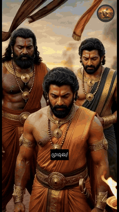

# YouTube Shorts Automation 🎬🤖

**An end-to-end, LLM-driven pipeline that turns a story idea into a finished, narrated, subtitled YouTube Short. Documented for portfolio and technical review.**

> **Note:** The implementation lives in a private repository. This repository documents the architecture, design decisions and technical depth of the project. Code walkthroughs are available on request.

---

## 📋 Project Summary

Producing a single short-form video by hand means writing a script, generating consistent visuals, recording narration, editing, adding subtitles and exporting for each platform. This project automates the whole chain.

Given a story idea (or an existing video to adapt), the pipeline:

1. **Writes the story** with an LLM and localises it into the target language (e.g. Tamil)
2. **Creates a hook** for the first seconds of the video
3. **Designs every character with a chain of AI agents** that research, design, validate and correct one canonical look per character
4. **Splits the story into scenes** with shot descriptions
5. **Generates image prompts and images** for every scene
6. **Animates images into video clips**
7. **Generates narration** with a multilingual text-to-speech model
8. **Composes the final video**: audio/video sync, subtitles, logo, subscribe outro, platform-specific export

The current production use case is a Tamil-language channel retelling stories from Indian epics such as the Mahabharata.

### 📺 See it in action

The Shorts on **[Tamil Ithihasa Kathaigal](https://www.youtube.com/@tamilithihasakathaigal-b8o/shorts)** are produced end to end by this pipeline.

**▶️ To watch the videos, [click here](https://www.youtube.com/@tamilithihasakathaigal-b8o/shorts).**

  
   
  <em>Clips from one generated Short: scenes, characters, narration and Tamil subtitles all produced automatically.</em>

## 🧠 What Makes It Interesting

- **Agentic character design.** A chain of specialised LLM agents builds one canonical appearance per character: a Scholar Researcher, a Vedic Iconographer and a Cinematic Assembler, followed by a strict Validator and a Rewriter. Characters then look the same in every scene. See [Agentic Character Design](docs/Agentic_Character_Design.md).
- **Global story memory.** The full script is analysed once to map every alias ("Partha", "Dhananjaya" → Arjuna) to one character, so scene prompts never drift.
- **Word-accurate subtitles.** Narration is generated with word-level timestamps, so subtitles (including word-by-word "kinetic" mode) stay exactly in sync with the voice.
- **Automatic quality gates.** Generated clips are checked for blur (frame difference / Laplacian variance at sampled points) and rejected as invalid if they fail. Stories are validated against a structured format (hook → narrative → reveal → closing message).
- **Provider-agnostic design.** LLMs, image generators, video generators and TTS engines sit behind factory interfaces, so a provider can be swapped in `config.yaml` without touching pipeline code.
- **Resilient by default.** Retries with exponential backoff, multi-LLM fallback (Gemini → OpenAI-compatible) and per-video state tracking let a long batch resume from the step that failed.
- **Batch and background processing.** A job queue runs video generation and composition in the background while the next story is being written.
- **Multi-platform output.** One composition step exports presets for YouTube Shorts, Instagram Reels, TikTok and Facebook Reels.

## 🏗️ Documentation

| Document | Contents |
|---|---|
| [Architecture](docs/Architecture.md) | Pipeline stages, data flow, module boundaries, state handling |
| [Agentic Character Design](docs/Agentic_Character_Design.md) | The multi-agent chain that keeps characters consistent |
| [Features](docs/Features.md) | What each stage does and how it is configured |
| [Tech Stack](docs/Tech_Stack.md) | Libraries, services and why they were chosen |

## 💼 What This Demonstrates

- **Pipeline and system design:** 15+ independent modules orchestrated through a single YAML configuration
- **Agentic AI:** multi-agent chains with specialised roles, a critic/validator loop and shared memory
- **LLM engineering:** templated prompts, structured JSON outputs, prompt logging, provider fallback
- **Media processing:** programmatic video editing, audio sync, subtitle generation, rendering performance tuning
- **Automation engineering:** browser automation, retry strategies, job queues, testable modules with pytest

## 👤 Author

**Kirsnaragavan Arudpiragasam**, Automation Test Engineer, Berlin
[Portfolio](https://krisharul26.github.io/KrishArul26/portfolio/index.html) · [LinkedIn](http://www.linkedin.com/in/arul-krisnaragavan) · [GitHub](https://github.com/KrishArul26)
